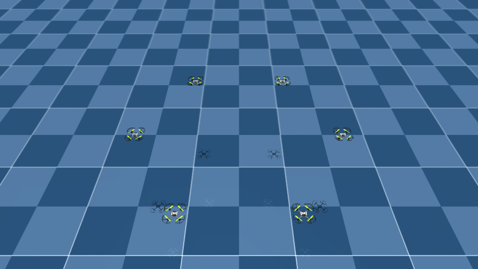
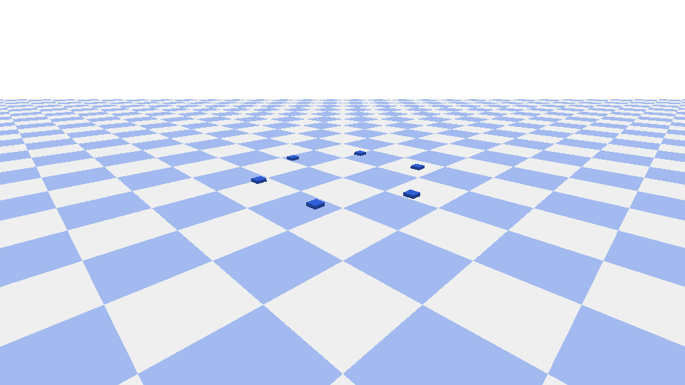

# 물리 엔진 비교 시험 (2026-11-10)

Crazyflow 0.4.0과 gym-pybullet-drones(PyBullet 3.2.7)를 비교했고, 2026-11-10에 Crazyflow로 정했다. 엔진은 `dsp/engine.py` 한 파일 뒤에 감춰 두었기 때문에 나중에 바꾸더라도 수업 코드는 그대로 쓸 수 있다.

## 시험 환경

- 노트북: Intel i5-1340P (12코어 16스레드), RAM 15 GB, Intel Iris Xe (a7a0), 디스크 여유 약 15 GB.
- 호스트 OS가 계획했던 24.04가 아니라 Ubuntu 20.04(ROS 1 Noetic)였다. 그래서 모든 시험은 Docker `osrf/ros:jazzy-desktop-full` 컨테이너(Ubuntu 24.04.4, Python 3.12.3, ROS 2 Jazzy apt 패키지) 안에서 했다.
- 컨테이너는 `--cpus=8`(16스레드의 절반)로 제한했고, 작업은 `nice`를 걸어 하나씩 돌렸다.
- 시험 스크립트: `tools/bakeoff/cf_test.py`, `tools/bakeoff/pb_test.py`.

## 기준별 결과

괄호 안은 판단할 때 둔 비중이다.

**① Python 3.12에 설치 (결정적).** Crazyflow는 `uv pip install crazyflow` 한 줄로 콜드 상태에서 39초 만에 설치됐다. jax 0.12.0.1, mujoco 4.0.0, numpy 2.5.4까지 모두 wheel이라 빌드가 필요 없다. 결과는 통과. PyBullet은 cp312 wheel이 없어 소스 빌드에 234초가 걸렸다. 이 이미지에는 gcc가 있어서 성공했지만 컴파일러가 없는 PC에서는 실패한 사례가 있다. gym-pybullet-drones는 PyPI에 없어서 `git clone` 후 `pip install -e`로만 설치할 수 있는데, 작업 환경의 보안 설정 때문에 내려받은 저장소를 빌드하지 못해 직접 돌려 보지는 못했다. 결과는 부분 통과.

**② 저수준 명령 직접 입력 (결정적).** Crazyflow는 `Control.force_torque`로 [총추력, τx, τy, τz]를 받는다. 모터 RPM 변환, 포화, 모터 동역학이 그 안에 들어 있다. `Control.rotor_vel`로 모터 4개의 RPM을 바로 줄 수도 있다. 우리 numpy 제어기로 한 대를 1 m에 호버시켰을 때 오차는 5 µm였다. world 좌표 외란을 `states.force`로 넣을 수 있는 것도 확인했다 (0.02 N을 주면 1초에 6.3 cm 밀림). 결과는 통과. PyBullet은 코어만으로 Crazyflie의 질량과 관성을 가진 상자를 만들어 `applyExternalForce/Torque`로 호버하는 데까지 성공했다. 모터 모델, 항력, RPM 인터페이스는 gym-pybullet-drones가 제공하는 부분이라 위의 이유로 확인하지 못했다. 결과는 부분 통과이고 추가 확인이 필요하다.

**③ `rclpy`와 같은 프로세스에서 실행 (높음).** 두 엔진 모두 `import rclpy`와 함께 불러와 `create_node`까지 문제없었다. 둘 다 통과.

**④ 6대 30초 호버 속도 (높음).** Crazyflow는 화면 없이 실시간 대비 4.97배, CPU 117 %(1코어 기준), 메모리 822 MB였다. 우리 래퍼(`dsp/engine.py`, 한 스텝에 jit 한 번)로 칩 6개, mocap, UDP까지 전체를 돌리면 3.4배다. PyBullet은 17.8배, CPU 100 %, 메모리 70 MB로 더 빨랐지만 모터 모델이 없는 상자였다.

**⑤ 화면 품질 (중간).** Crazyflow는 프로펠러와 보드까지 있는 Crazyflie 실제 메시로 그린다. PyBullet은 상자로 그렸다 (gym-pybullet-drones의 cf2x URDF는 확인하지 못함).

| Crazyflow (MuJoCo, offscreen) | PyBullet (TinyRenderer) |
|---|---|
|  |  |

**⑥ 첫 실행 지연 (낮음).** Crazyflow는 import 2.75초, Sim 생성 1.24초, 첫 스텝 JIT 0.27초가 걸린다. PyBullet은 거의 0초다.

## 3D 창 성능

컨테이너 안의 Mesa iris 드라이버가 이 커널(6.16)에서 GPU를 열지 못했다 (`Kernel is too old (4.16+ required) or unusable for Iris`). 그래서 소프트웨어 렌더링(llvmpipe)으로 돈다. 960×540 오프스크린 기준으로 Crazyflow 5.4 FPS, PyBullet 9.1 FPS였다.

대응으로 `dsp/viz.LiveView`는 벽시계 기준으로 정한 fps까지만 그리고 시뮬레이션은 기다리지 않게 만들었다. 창을 켜도 시뮬레이션은 실시간을 지킨다. 영상이 필요하면 `--video`로 오프스크린 저장을 하거나, 기록을 `viz.save_video`로 matplotlib 영상으로 만든다. Ubuntu 24.04를 별도 SSD로 직접 부팅하면 호스트 Mesa로 GPU 가속이 될 가능성이 높지만 아직 확인하지 않았다.

## 판단

gym-pybullet-drones는 Python 3.12에서 소스 빌드에 의존하고 PyPI 배포도 없다. 부원 여섯 명의 노트북에 깔기에는 위험하다. 저수준 명령도 코어 수준에서만 확인했다.

Crazyflow는 설치, 저수준 명령, `rclpy`와의 공존이 모두 깔끔했다. 모터 RPM과 회전 동역학을 포함한 first-principles 모델에 외란 입력까지 있고, 2026년 논문 기준으로 시뮬레이션과 실제의 차이도 더 작다고 보고됐다. 속도는 PyBullet이 빠르지만 Crazyflow도 6대 전체 스택을 3.4배로 돌리니 충분하다.

그래서 Crazyflow를 골랐다. 기체 모델은 `cf2x_T350`(37.9 g, 최대 추력 0.72 N, 추력 대 중량비 1.94)이다. ESP32-S3 브러시드 마이크로 드론(35~45 g)과 가장 비슷하고, 질량 +10 % 시험에서도 추력 여유가 있다. `cf21B_500`(43.4 g, 1.88)과 `cf2x_L250`(32.8 g, 1.49)은 여유가 부족했다.

## 남은 결정

- 엔진: Crazyflow로 확정 (2026-11-10).
- 기체 모델: 지금은 `cf2x_T350`(`dsp/config.py`의 `DRONE_MODEL`). 운영진이 25 cm급 기체를 생각하고 있어서 다시 정해야 한다.
